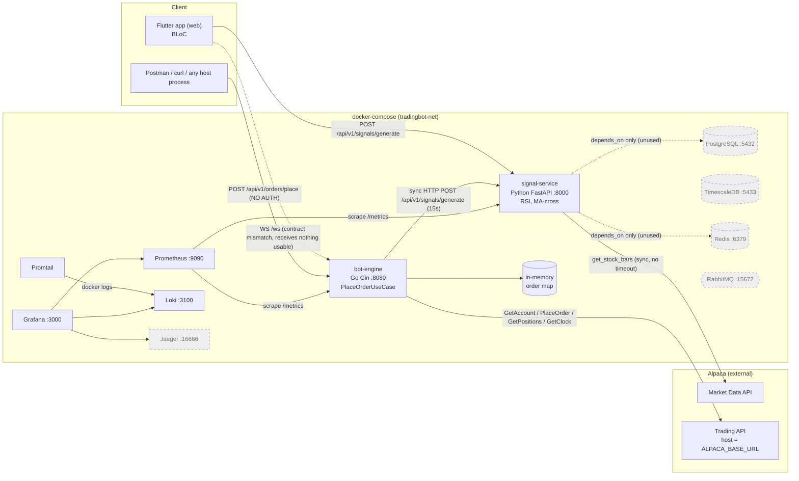

# Current Architecture (as implemented)

This document describes **what the code does today** (commit `37c63ff`), not what the README describes. Every edge in the diagram is backed by code; deployed-but-unused components are drawn dashed and grey.

## 1. Runtime diagram

## 2. Components

| Component | Status | Role today | Evidence |
|---|---|---|---|
| signal-service | Implemented | Stateless signal computation on Alpaca bars | `signal-service/src/api/routes/signals.py` |
| bot-engine | Implemented | Synchronous "signal → risk → order" pipeline, portfolio read, WS broadcast | `bot-engine/main.go`, `usecases/place_order.go` |
| Flutter app | Partial | Signal request + mock portfolio | `app/lib/...` |
| Order store | Partial | In-memory map, lost on restart | `repository/inmemory_order_repo.go` |
| PostgreSQL / TimescaleDB / Redis / RabbitMQ | **Deployed, unused** | — | No client libraries in any service |
| Prometheus / Grafana / Loki / Promtail | Implemented | Metrics and log collection | `infra/monitoring/` |
| Jaeger | **Deployed, receives nothing** | — | No OTel exporter configured |

## 3. Communication

| From → To | Style | Contract | Timeout | Retry |
|---|---|---|---|---|
| bot-engine → signal-service | Sync REST | Hand-mirrored struct (`signalclient/client.go:19-30`) | 15 s | None |
| signal-service → Alpaca data | Sync SDK in async handler | alpaca-py | **None** | None |
| bot-engine → Alpaca trading | Sync SDK | alpaca-trade-api-go v3 | SDK default; `ctx` ignored | None (circuit breaker unwired) |
| bot-engine → app | WebSocket push | Untyped `{"type","payload"}` | 60 s read deadline | Client reconnects every 3 s |
| app → signal-service | REST | `SignalEntity.fromJson` | 15 s | None |
| Asynchronous messaging | **None** | — | — | — |

## 4. Data ownership

There is effectively **no persisted data**:

- Signals are computed and returned, never stored.
- Orders sit in a process-local map in bot-engine.
- Positions and equity are read live from Alpaca each time.

The schema in `infra/postgres/init.sql` (`signals`, `orders`, `trades`) has no writer.

## 5. Failure propagation

| Failure | Effect |
|---|---|
| Alpaca data slow or hung | signal-service worker event loop blocks, so all requests on that worker stall. bot-engine times out after 15 s and returns 500. |
| signal-service down | bot-engine returns 500 "fetching signal". `/health/ready` of bot-engine still says ready. |
| Alpaca trading error after order accepted | The handler may exceed `WriteTimeout` (15 s) while the order is already placed, so the client sees an error and may retry, creating a duplicate (no idempotency). |
| bot-engine restart | All order history is lost. Open broker orders are not reconciled. |
| Postgres/Redis down | signal-service will not *start* in Compose (`depends_on: service_healthy`) even though it doesn't use them. |

## 6. Observability coverage

| Signal | signal-service | bot-engine |
|---|---|---|
| Structured logs | Yes (structlog JSON) | Yes (zap) |
| HTTP metrics | Yes | Yes (status label is text) |
| Business metrics | Declared, never incremented | None |
| Traces | None | Spans created, not exported |
| Health | Static (no dependency checks) | Static |
| Alerts | None | None |

## 7. Deployment targets present in repo

| Target | Files | Deployable as-is? |
|---|---|---|
| Docker Compose (root) | `docker-compose.yml` | Yes (validated with `docker compose config`) |
| Docker Compose (signal-service) | `signal-service/docker-compose.yml` | **No** (wrong build path) |
| Fly.io | `*/fly.toml` | Not verified; app names inconsistent with Makefile |
| Kubernetes | `*/signal-service.yml`, `*/bot-engine.yml` | **No** (placeholder images, missing DB/Redis services) |
