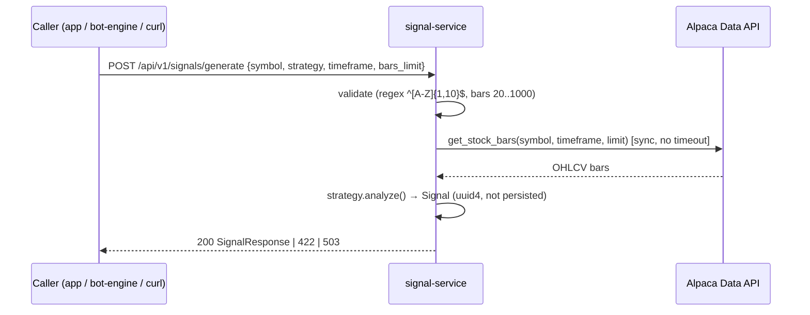
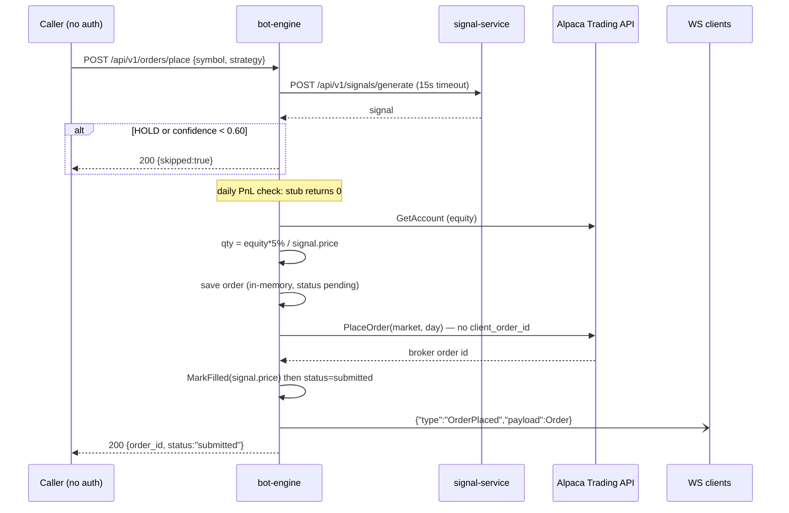

# Data Flows

Section 1 shows **current** flows, verified in code. Section 2 shows **proposed** flows (not implemented).

## 1. Current flows

### 1.1 Generate signal (app or any caller → signal-service)



Evidence: `signal-service/src/api/routes/signals.py:62-144`, `src/application/generate_signal.py:47-97`, `src/infrastructure/adapters/alpaca_market_data.py:44-98`.

### 1.2 Place order (any caller → bot-engine), current, unsafe



Evidence: `bot-engine/internal/application/usecases/place_order.go:72-183`.

Gaps in this flow: no auth, no idempotency, no market-hours check, no position check for SELL, no persistence, fill price fabricated from the signal, and the WS payload is not understood by the app.

### 1.3 Portfolio read

`GET /api/v1/portfolio/equity` → Alpaca `GetAccount` + `GetClock`; `GET /api/v1/portfolio/positions` → Alpaca `GetPositions`. No caching. `paper_mode` is hardcoded `true` (`handlers/portfolio.go:45-60,80-100`).

### 1.4 Live events (bot-engine → app)

The engine broadcasts `OrderPlaced` only. The app listens for `type == "signal"` only, so **no event is ever consumed** (TD-12).

### 1.5 Telemetry

- Logs: container stdout → Promtail (docker_sd, label `com.docker.compose.project=signal-trading`) → Loki → Grafana.
- Metrics: Prometheus scrapes `signal-service:8000/metrics` and `bot-engine:8080/metrics` every 15 s.
- Traces: none exported.

## 2. Proposed flows (not implemented)

### 2.1 Agent market analysis (M1, read-only)

```mermaid
sequenceDiagram
    participant A as Agent (MCP client)
    participant G as agent-gateway (MCP)
    participant SS as signal-service
    participant R as Redis cache
    participant AD as Alpaca Data
    A->>G: tools/call generate_signal(AAPL, rsi)
    G->>G: check agent identity + scope "market:read"; audit log
    G->>SS: POST /api/v1/signals/generate (service token)
    SS->>R: bars cached?
    alt miss
        SS->>AD: get bars (async, timeout)
        SS->>R: set TTL
    end
    SS-->>G: signal
    G-->>A: structured result (no execution capability exposed)
```

### 2.2 Order intent with approval (M3+, after ADR-005 implementation)

```mermaid
sequenceDiagram
    participant A as Agent / App
    participant BE as bot-engine Execution API
    participant RK as Risk engine
    participant H as Human approver
    participant EX as Executor (single writer)
    participant AT as Alpaca (paper)
    A->>BE: POST /api/v1/order-intents (Idempotency-Key, scope intent:create)
    BE->>BE: dedupe by key / signal_id; persist intent + audit event
    BE->>RK: pre-trade checks (mode, kill switch, hours, limits, positions)
    alt rejected or any input unavailable
        RK-->>BE: reject (fail closed)
        BE-->>A: 422 rejected + reason
    else passed
        BE-->>A: 202 pending_approval
        H->>BE: approve intent (scope intent:approve)
        BE->>RK: re-check (state may have changed)
        BE->>EX: execute
        EX->>AT: PlaceOrder(client_order_id = intent id)
        AT-->>EX: accepted
        Note over EX,AT: reconciler updates fills from trade updates
    end
```
