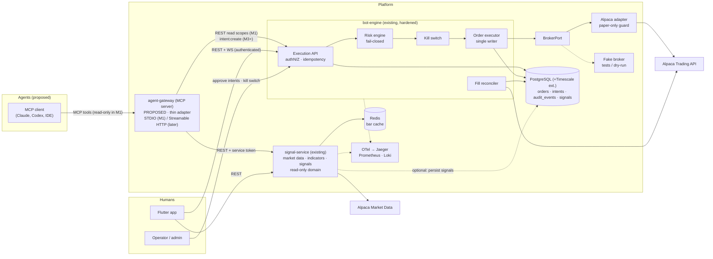

# Target Architecture (proposed)

**Status: Proposed.** Nothing in this document is implemented unless marked otherwise. Decisions are recorded as ADRs in `docs/adr/` and are *Proposed* until the owner accepts them.

## 1. Guiding principles

1. **Reduce complexity before adding it.** Keep the two existing services (Python, Go). Add only one new process: a thin Agent Integration Layer (MCP). Infrastructure that has no consumer is removed from the default profile until it gets one.
2. **Single execution authority.** Only `bot-engine` can talk to the broker's trading API. Agents, the app, and signal-service never do.
3. **Fail closed.** Missing data, an unknown mode, or an unavailable dependency means *no order*.
4. **Read before write.** The agent platform ships read-only first (M1). Write capabilities arrive only as *order intents* that pass risk checks and, initially, human approval.
5. **The MCP layer contains no trading logic.** It translates tool calls to existing REST APIs and enforces agent identity and scope. Validation, risk, and execution remain in bot-engine.

## 2. Target diagram

## 3. Changes relative to current architecture

| Area | Current | Target | Milestone | ADR |
|---|---|---|---|---|
| Agent access | None | MCP server, read-only tools | M1 | ADR-002, ADR-003 |
| Service auth | None | Service tokens with scopes; OIDC when a remote transport is introduced | M1 (tokens) / later (OIDC) | ADR-003 |
| Paper/live | Unguarded URL | Startup guard bound to paper host; live requires an explicit ADR | M1 | ADR-005 |
| Order endpoint | Open, direct execution | Disabled by default; then `order_intent` → risk → (approval) → execute | M1 (disable) / M3 | ADR-005 |
| Idempotency | None | `Idempotency-Key` + `client_order_id` + unique constraints | M3 | ADR-005 |
| Risk | 2 of 6 rules | Full pre-trade checklist, fail-closed | M3 | ADR-005 |
| Persistence | In-memory | Postgres with migrations; audit log append-only | M2 | — |
| Broker abstraction | `BrokerPort` (Alpaca only) | `BrokerPort` v2 + fake broker + capability flags | M2 | ADR-004 |
| Messaging | RabbitMQ deployed, unused | **Deferred.** Removed from default profile. Reintroduced only for a concrete async flow (e.g. scheduled signal scans → intents) | Later | (future ADR) |
| TimescaleDB | Separate unused instance | Single Postgres instance with Timescale extension, when bar storage is needed | Later | (future ADR) |
| Market data calls | Blocking, no timeout | Non-blocking, timeout, Redis TTL cache | M1 | — |
| Observability | Logs and metrics only | OTel traces exported; business metrics; alerts | M2 | — |
| Repo | Monorepo | Monorepo retained; `agent-gateway/` added | M1 | ADR-001 |

## 4. Agent Integration Layer (future component)

**Proposed** directory: `agent-gateway/`. Language is to be decided in ADR-002; Python with the official MCP SDK is recommended.

M1 tool surface (read-only):

| Tool | Backed by | Side effects |
|---|---|---|
| `list_strategies` | `GET signal-service /api/v1/signals/strategies` | None |
| `generate_signal(symbol, strategy, timeframe, bars)` | `POST signal-service /api/v1/signals/generate` | None (computes on demand) |
| `get_portfolio_summary` | `GET bot-engine /api/v1/portfolio/equity` (read scope) | None |
| `get_positions` | `GET bot-engine /api/v1/portfolio/positions` (read scope) | None |
| `get_trading_mode` | New read endpoint returning the *verified* paper/live state | None |

Explicitly **excluded** until ADR-005 is implemented: any tool that creates, modifies, or cancels orders.

## 5. Non-goals

- No new business microservices (risk, portfolio, and execution stay inside bot-engine).
- No live trading.
- No replacement of Python or Go.
- No Kubernetes work until a target environment exists. The manifests stay, marked non-deployable.
